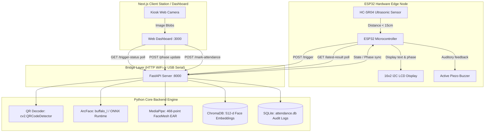

# Smart Attendance System: Complete Codebase & Architecture Analysis

## 1. Executive Summary & System Overview

The **Smart Attendance System** is an end-to-end, edge-to-cloud IoT biometric verification solution designed for institutional environments (classrooms, office turnstiles, secure labs). It integrates **ESP32 microcontroller hardware**, **computer vision deep learning models**, a **vector database**, a **FastAPI backend**, and a **Next.js web dashboard**.

The system addresses the core vulnerabilities of traditional attendance systems (buddy punching, static photo spoofing, card-passing fraud) by implementing a **Two-Factor Biometric Verification Pipeline**:
1. **Factor 1 (Possession / Claim):** QR code encoded on a student or employee physical badge.
2. **Factor 2 (Biometric Inherent):** 512-dimensional facial recognition vector matching via ArcFace + Active Eye-Blink Liveness Detection via MediaPipe.

Attendance is only committed if and only if:
$$\text{Decoded QR Code} == \text{Biometric Predicted Code} \quad \text{AND} \quad \text{Cosine Similarity} \ge 0.40$$

---

## 2. High-Level Architecture Diagram



---

## 3. Backend Technology Stack & Libraries

The backend uses a modern, high-performance Python 3.13+ asynchronous stack managed via `uv` / `pyproject.toml` and `requirements.txt`.

| Library | Version Spec | Exact Purpose in Codebase | Why It Was Chosen |
| :--- | :--- | :--- | :--- |
| **`fastapi`** | `>=0.115.0` (`>=0.141.1`) | Core web framework powering REST endpoints (`/enroll`, `/mark-attendance`, `/trigger`, etc.) and WebSocket state streaming. | Ultra-high ASGI performance, native asynchronous request handling, automatic request validation via Pydantic, and automatic OpenAPI documentation. |
| **`uvicorn[standard]`** | `>=0.30.0` (`>=0.52.4`) | High-speed ASGI HTTP & WebSocket server implementation using `uvloop` and `httptools`. | Production-grade async server capable of handling concurrent polling requests from both the ESP32 and web frontend simultaneously. |
| **`insightface`** | `>=0.7.3` (`>=1.0.1`) | Deep learning face analysis toolbox. Loads the `buffalo_l` model bundle (RetinaFace detector + ArcFace recognition model). | State-of-the-art ArcFace (Additive Angular Margin Loss) produces discriminative 512-dimensional normalized face vectors that separate identical twins and different lighting conditions. |
| **`onnxruntime`** | `>=1.18.0` (`>=1.29.0`) | Cross-platform inference accelerator executing the compiled `.onnx` weight graphs for RetinaFace and ArcFace. | Delivers CPU-optimized inference (AVX2/AVX-512) without requiring heavy CUDA/GPU hardware, executing face detection and embedding in sub-100ms on standard CPUs. |
| **`chromadb`** | `>=0.5.0` (`>=1.5.9`) | Embedded vector database storing 512-d face vectors in `./data/chroma_db` using an HNSW cosine space index. | Sub-millisecond vector similarity search ($1 - \text{cosine distance}$). Allows multiple face embeddings per student for varying poses and lighting. |
| **`opencv-python-headless`** | `>=4.10.0` (`>=5.0.0`) | Computer vision image processing, color space conversion (`RGB <-> BGR`), QR code detection (`cv2.QRCodeDetector`), camera capture (`cv2.VideoCapture`), and sharpness calculation (`cv2.Laplacian`). | Industry standard for matrix manipulation and image transformation. The `headless` variant is lightweight and does not bundle heavy GUI/X11 dependencies. |
| **`mediapipe`** | `>=0.10.14` | Google's machine learning framework for tracking 468/478 3D facial landmarks in real time. | Provides micro-precision eyelid landmark coordinate extraction for calculating Eye Aspect Ratio (EAR) anti-spoofing blink checks. |
| **`pillow` (`PIL`)** | `>=10.4.0` (`>=12.3.0`) | Robust image reading from raw multipart uploaded bytes (`io.BytesIO`) into standard image buffers. | Handles image normalization, format parsing (JPEG, PNG, WebP), and color channel standardization before OpenCV conversion. |
| **`numpy`** | `>=1.26.0` (`>=2.5.2`) | Foundational tensor and array manipulation. Used for L2 vector normalization (`np.linalg.norm`), Euclidean distance math, and embedding reshaping. | C-speed numerical operations on multidimensional arrays. |
| **`pyserial`** | `>=3.5` | Serial communication interface for USB UART communication with the ESP32 (e.g. `COM3` on Windows or `/dev/ttyUSB0` on Linux). | Provides auto-detection of USB-UART bridges (CP2102, CH340, FTDI) and bi-directional raw serial command transmission. |
| **`python-multipart`** | `>=0.0.9` (`>=0.0.32`) | Form-data and binary streaming parser for FastAPI upload endpoints. | Enables asynchronous streaming of image uploads (`UploadFile`) directly from frontend webcams and mobile phones. |
| **`sqlite3`** | Standard Library | Local relational database for persistent chronological attendance logging (`./data/attendance.db`). | Zero-configuration, serverless, self-contained, ACID-compliant database for tabular event logs and timestamps. |

---

## 4. Deep-Dive Codebase Structure & Module Analysis

```
Smart-attendace/
├── attendance-backend/
│   ├── app/
│   │   ├── __init__.py             # Module root
│   │   ├── main.py                 # FastAPI application, REST endpoints, and phase-bridge state
│   │   ├── model.py                # InsightFace / ArcFace embedding extraction & model lifecycle
│   │   ├── db.py                   # ChromaDB vector store client, indexing, and vector queries
│   │   ├── attendance_log.py       # SQLite database persistence layer for attendance records
│   │   ├── device_controller.py    # Hardware state machine, serial manager, EAR liveness, camera loop
│   │   └── qr.py                   # OpenCV QRCodeDetector wrapper
│   ├── data/
│   │   ├── attendance.db           # SQLite database file
│   │   └── chroma_db/              # Persistent ChromaDB parquet/sqlite vector store
│   ├── esp32_attendance_firmware_wifi.ino # Production ESP32 firmware (WiFi / HTTP polling)
│   ├── pyproject.toml              # Modern Python build config & dependencies (uv)
│   └── requirements.txt            # Traditional pip dependency manifest
└── frontend/
    ├── app/
    │   ├── layout.tsx              # Root HTML shell & metadata
    │   ├── globals.css             # Tailwind CSS & UI design tokens
    │   └── page.tsx                # Complete interactive single-page dashboard & kiosk station
    ├── lib/
    │   └── api.ts                  # Typed TypeScript API client & WebSocket connector
    └── package.json                # Next.js 16, React 19, Lucide icons, Tailwind
```

### 4.1. `app/model.py` — The Biometric Embedding Engine
- **Lazy Initialization (`get_model`):**
  Uses a module-level singleton `_app`. On first access, it downloads and prepares the `buffalo_l` pack (~350MB) with `CPUExecutionProvider` and detection resolution `(640, 640)`. This guarantees no redundant re-instantiations across requests.
- **Bounding Box Sizing & Largest Face Selection:**
  When multiple faces appear in frame, `get_embedding()` calculates the bounding box area $(x_2 - x_1) \times (y_2 - y_1)$ for every detected face and sorts in descending order:
  ```python
  faces.sort(key=lambda f: (f.bbox[2] - f.bbox[0]) * (f.bbox[3] - f.bbox[1]), reverse=True)
  ```
  This selects the primary student standing closest to the station.
- **L2 Vector Normalization:**
  The raw 512-dimensional output embedding is normalized to unit length:
  $$\hat{\mathbf{e}} = \frac{\mathbf{e}}{\|\mathbf{e}\|_2}$$
  This ensures that the Euclidean dot product directly equals the cosine similarity.

### 4.2. `app/db.py` — Vector Database & Cosine Index
- **ChromaDB Client:**
  Instantiates `chromadb.PersistentClient(path="./data/chroma_db")` and creates a collection called `"faces"` configured with `metadata={"hnsw:space": "cosine"}`.
- **Cosine Space Distance Mapping:**
  In Chroma's cosine metric, the returned distance $d$ relates to cosine similarity $s$ by:
  $$s = 1 - d$$
  A distance of $0.0$ indicates identical vectors ($1.0$ similarity).
- **Multi-Shot Enrollment Strategy:**
  For each student, the system allows enrolling multiple images (5–8 angles, with and without glasses). Each entry is indexed as `{code}__{index}` with metadata containing `{"code": code, "name": name}`.
- **Top-K Retrieval:**
  Queries Chroma with the query embedding for the top $k=5$ closest matches, iterating through to find the single highest cosine similarity score.

### 4.3. `app/attendance_log.py` — Audit Logging & Persistence
- Maintains the SQLite database schema:
  ```sql
  CREATE TABLE IF NOT EXISTS attendance (
      id INTEGER PRIMARY KEY AUTOINCREMENT,
      code TEXT NOT NULL,
      name TEXT,
      similarity REAL NOT NULL,
      timestamp TEXT NOT NULL
  );
  ```
- All timestamps are recorded in strict ISO 8601 UTC format (`datetime.now(timezone.utc).isoformat()`).

### 4.4. `app/qr.py` — QR Credential Decoding
- Uses `cv2.QRCodeDetector()` to locate and decode standard QR codes embedded on student identification cards. Returns `None` if unreadable or absent.

### 4.5. `app/main.py` — Central Coordination & State Bridge
Serves as the central switchboard. It holds shared in-memory bridge state:
```python
trigger_state = {"active": False, "triggered_at": None}
latest_result = {"available": False, "phase": "idle"}
```
- **Debounced Trigger (`POST /trigger`):**
  Enforces a 5-second cooldown window so an ultrasonic sensor bouncing readings cannot trigger overlapping attendance cycles.
- **Phase Sync (`POST /phase` & `GET /latest-result`):**
  Allows the frontend station to report its current step (`scanning_qr` -> `blink` -> `processing` -> `done`), which the ESP32 fetches on its 1-second polling loop to update the hardware LCD display live.
- **Verification Logic (`_process_attendance_match`):**
  Executes the cross-check between the QR code and the biometric prediction. Marks attendance if both match and confidence is $\ge 0.40$.

### 4.6. `app/device_controller.py` — Standalone Hardware Loop & Liveness
Can operate either via USB Serial or WiFi HTTP.
- **Eye Aspect Ratio (EAR) Blink Detection:**
  Uses 6 landmark coordinates per eye from MediaPipe FaceMesh:
  $$\text{EAR} = \frac{\|p_2 - p_6\| + \|p_3 - p_5\|}{2 \cdot \|p_1 - p_4\|}$$
  When eyes are open, EAR is typically $\ge 0.24$. When blinking, it dips below $0.21$. The state machine requires an eye closure followed by reopening within a 3-second burst window.
- **Laplacian Variance Sharpness Selector:**
  Analyzes incoming camera frames using `cv2.Laplacian(gray, cv2.CV_64F).var()`. The frame with the highest variance (sharpest, least motion blur) is sent to ArcFace.

---

## 5. How the ESP32 and Backend Go Hand in Hand

The integration between the ESP32 microcontroller and the server constitutes a closed-loop cyber-physical system.

### 5.1. Hardware Schematic & Wiring Pinout

| Peripheral | Component | ESP32 GPIO Pin | Electrical Function |
| :--- | :--- | :--- | :--- |
| **Proximity Trigger** | HC-SR04 Ultrasonic Sensor | **GPIO 5** | `TRIG` (10µs output pulse) |
| | HC-SR04 Ultrasonic Sensor | **GPIO 18** | `ECHO` (Pulse width input proportional to distance) |
| | HC-SR04 Power | 5V / GND | 5V Power and Ground |
| **Visual Feedback** | 1602 LCD with I2C Backpack | **GPIO 21** | `SDA` (I2C Data line at address `0x27`) |
| | 1602 LCD with I2C Backpack | **GPIO 22** | `SCL` (I2C Clock line at address `0x27`) |
| | 1602 LCD Power | 5V / GND | Backlight and display power |
| **Auditory Feedback** | Active Piezo Buzzer | **GPIO 4** | High/Low logic level driving acoustic beeps |
| | Buzzer Ground | GND | Ground |

---

### 5.2. Communication Protocol & Handshake Lifecycle

The system operates primarily via **WiFi HTTP REST Handshake** (firmware: `esp32_attendance_firmware_wifi.ino`):

```
+---------------+                +-------------------+               +--------------------+
|     ESP32     |                |  FastAPI Backend  |               |  Frontend Station  |
+---------------+                +-------------------+               +--------------------+
       |                                   |                                    |
  [Measures < 15cm]                        |                                    |
       |----- POST /trigger -------------->|                                    |
       |                                   | [Sets trigger_state.active = true] |
       |                                   |                                    |
       |                                   |<---- GET /trigger-status (poll) ---|
       |                                   |---- {active: true} --------------->|
       |                                   |                                    |
       |                                   |                              [Starts Camera]
       |                                   |                              [Phase 1: QR]
       |                                   |<---- POST /phase: scanning_qr -----|
       |<---- GET /latest-result (poll) ---|                                    |
       |      {phase: "scanning_qr"}       |                                    |
 [LCD: "Scan your ID card"]                |                                    |
       |                                   |                                    |
       |                                   |                              [Decodes QR]
       |                                   |                              [Phase 2: Blink]
       |                                   |<---- POST /phase: blink -----------|
       |<---- GET /latest-result (poll) ---|                                    |
       |      {phase: "blink"}             |                                    |
 [LCD: "Look & blink", Beep!]              |                                    |
       |                                   |                                    |
       |                                   |                              [Snaps Face]
       |                                   |                              [Phase 3: Verify]
       |                                   |<---- POST /phase: processing ------|
       |<---- GET /latest-result (poll) ---|                                    |
       |      {phase: "processing"}        |                                    |
 [LCD: "Verifying..."]                     |                                    |
       |                                   |<---- POST /mark-attendance --------|
       |                                   |      (image + decoded_qr)          |
       |                                   |                                    |
       |                                   | [ArcFace Embedding Extraction]     |
       |                                   | [ChromaDB Cosine Match]            |
       |                                   | [Match verified & logged in SQLite]|
       |                                   |---- {marked: true, name: ...} ---->|
       |                                   |                                    |
       |<---- GET /latest-result (poll) ---|                                    |
       |      {available: true, ...}       |                                    |
       |                                   |                                    |
 [LCD: "John Doe Present"]                 |                                    |
 [Buzzer: 200ms Beep!]                     |                                    |
       |                                   |                                    |
 [Waits 4s -> LCD: "Ready"]                |                                    |
```

### 5.3. Real-Time Hardware Synchronizations

1. **Active Proximity Detection:**
   The ESP32 firmware continuously transmits a 10µs pulse on GPIO 5 and times the reflection via `pulseIn(GPIO 18)`.
   $$\text{Distance (cm)} = \frac{\text{Duration in } \mu\text{s} \times 0.034}{2}$$
   When an individual steps within $15\text{ cm}$, the cycle is triggered.

2. **Phase Bridge for Live User Guidance:**
   Instead of a static "Processing" message, the ESP32 displays dynamic prompts driven by the web camera's actual progress:
   - `scanning_qr`: LCD displays Line 1: `Scan your ID`, Line 2: `card QR code...`
   - `blink`: LCD displays Line 1: `Look at camera`, Line 2: `and blink now`, accompanied by a short 80ms prompt beep.
   - `processing`: LCD displays Line 1: `Verifying...`, Line 2: `Please wait`.

3. **Auditory & Visual Result Feedback:**
   - **Verification Success:** LCD shows `<Student Name>` on line 1 and `Present` on line 2. The buzzer produces a confident single long beep (200ms).
   - **Verification Failure / Impersonation:** LCD shows `Not Verified` / `Try Again`. The buzzer produces two short alert beeps (100ms on, 100ms off, 100ms on).

---

## 6. Frontend Dashboard Architecture

The Next.js 16 (React 19, TypeScript, Tailwind CSS) web application serves as both the **interactive station terminal** and the **administrative dashboard**:

- **Kiosk Mode (Live Attendance Station):**
  - Connects to the local webcam via `navigator.mediaDevices.getUserMedia()`.
  - Runs a fast polling loop (every 500ms) to `GET /trigger-status`.
  - Orchestrates countdown animations, real-time camera viewfinder overlays, bounding reticles, and biometric telemetry badges.
- **Student Enrollment Interface:**
  - Multi-shot enrollment form capturing student name, registration ID code, and live camera snapshots or file uploads.
  - Submits to `POST /enroll` to generate and index embeddings in ChromaDB.
- **Enrolled Database Manager:**
  - Lists all enrolled students with total image count per individual.
  - Allows single-click deletion (`DELETE /students/{code}`) which cleans all associated vectors from ChromaDB.
- **Model & QR Standalone Tester:**
  - Allows diagnostics on raw images: tests QR decoding independent of face recognition, and tests ArcFace inference similarity scores on arbitrary images.
- **Live Audit Logs:**
  - Fetches the most recent 50 attendance events from SQLite with timestamps, confidence scores, and verification status.

---

## 7. Complete API Reference

| Method | Endpoint | Request Body | Response Payload | Description |
| :--- | :--- | :--- | :--- | :--- |
| `GET` | `/health` | None | `{"status": "ok"}` | System liveness probe. |
| `POST` | `/trigger` | None | `{"status": "triggered"}` or `{"status": "debounced"}` | Triggered by ESP32 ultrasonic sensor. |
| `POST` | `/trigger/reset`| None | `{"status": "reset"}` | Clears active trigger state. |
| `GET` | `/trigger-status`| None | `{"active": bool, "triggered_at": float}` | Polled by frontend to detect hardware trigger. |
| `POST` | `/phase` | `{"phase": "scanning_qr" \| "blink" \| "processing"}` | `{"status": "ok", "phase": ...}` | Synchronizes stage between frontend and ESP32 LCD. |
| `GET` | `/latest-result`| None | `{"available": bool, "phase": str, "marked": bool, ...}` | Polled by ESP32 to receive verification outcome. |
| `POST` | `/enroll` | `name: Form`, `code: Form`, `image: File` | `{"status": "enrolled", "code": ..., "entry_id": ...}` | Enrolls a face embedding into ChromaDB. |
| `GET` | `/students` | None | `{"students": [{"code": ..., "name": ..., "image_count": ...}]}` | Lists all registered students. |
| `DELETE`| `/students/{code}`| None | `{"status": "deleted", "images_removed": int}` | Deletes all vectors for the specified student. |
| `POST` | `/infer` | `image: File` | `{"match": bool, "code": ..., "name": ..., "similarity": float}` | Standalone face identification endpoint. |
| `POST` | `/qr-decode` | `image: File` | `{"data": str}` | Decodes QR code from uploaded image. |
| `POST` | `/mark-attendance`| `qr_code: Form`, `image: File` | `{"marked": bool, "code": ..., "name": ..., "similarity": float}` | Core 2FA verification and attendance logging. |
| `POST` | `/mark-attendance-single`| `image: File` | `{"marked": bool, "code": ..., "name": ..., "similarity": float}` | Extracts both QR and face from a single image. |
| `GET` | `/attendance/recent`| `limit: int` (default 50) | `{"records": [...]}` | Retrieves attendance history from SQLite. |
| `GET` | `/device-state` | None | Current `device_controller` state dict | Hardware state inquiry. |
| `POST` | `/device/trigger`| None | `{"status": "triggered"}` | Programmatic trigger for testing. |
| `WS` | `/ws/device-state`| WebSocket stream | Live JSON state broadcasts | Real-time device state pushing. |

---

## 8. Summary of System Strengths & Engineering Highlights

1. **Separation of Concerns:** The ESP32 handles physical sensing, user signaling, and distance detection; the frontend manages high-resolution video streams and kiosk UI; the FastAPI backend performs CPU-heavy linear algebra and vector lookups.
2. **Resilience to False Triggers:** 5-second software debouncing prevents ultrasonic sensor jitter from overwhelming the server.
3. **Decoupled Deployment:** Can be used either via WiFi HTTP (allowing the ESP32 to be placed across the room from the server) or direct USB serial tethering.
4. **Vector Scaling:** ChromaDB's HNSW index scales to thousands of enrolled students without noticeable latency degradation compared to flat brute-force search.

